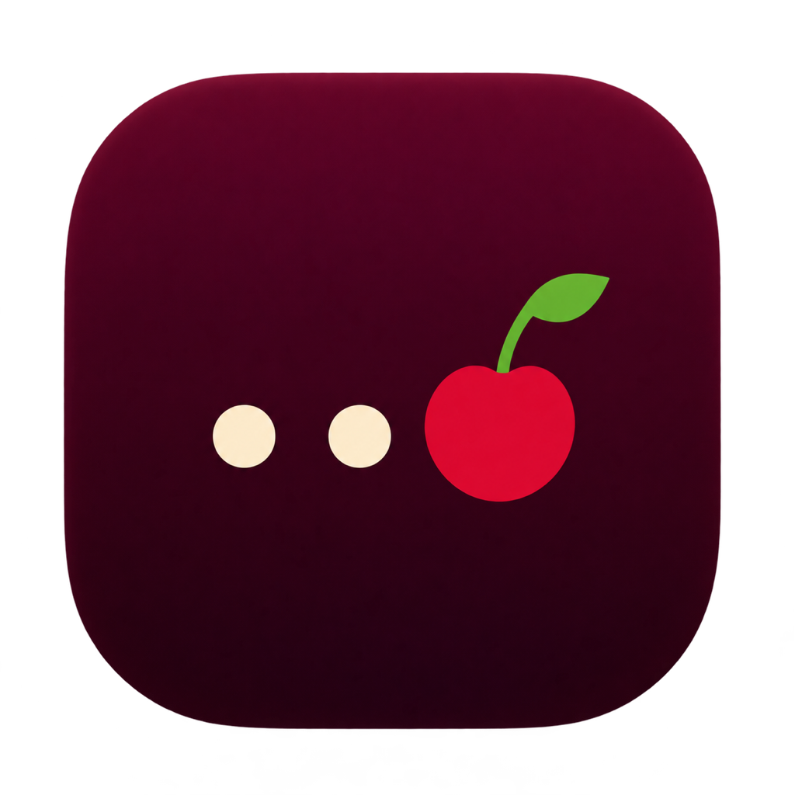
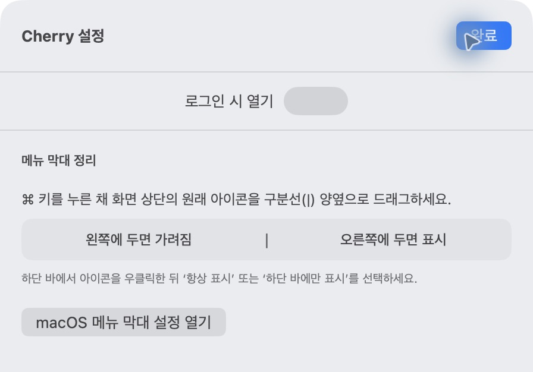

# Cherry



Cherry는 Mac 메뉴 막대에서 자주 쓰는 아이콘만 골라 두고, 나머지는 필요할 때 꺼내 쓰는 메뉴 막대 정리 앱입니다. 맥북 노치 뒤에 가려진 아이콘도 `…` 아래 가로 목록에서 찾고, 해당 앱의 원래 메뉴를 열 수 있어요.

**모요에서 만들었습니다.**

## 설치

**macOS 14 이상**에서 사용할 수 있습니다. DMG는 Apple Silicon과 Intel Mac을 모두 지원합니다.

1. [GitHub Releases](https://github.com/xeromank/cherry/releases)에서 `Cherry-0.2.0-macOS-universal.dmg`를 내려받습니다.
2. DMG를 열어 `Cherry.app`을 **응용 프로그램** 폴더에 끌어다 놓고 실행합니다.
3. 첫 실행 화면에서 **권한 요청**을 누릅니다. **시스템 설정 → 개인정보 보호 및 보안 → 손쉬운 사용**에서 **Cherry**를 허용합니다.

공개 프리뷰 DMG는 Apple 공증 전이라 Mac 설정에 따라 첫 실행이 차단될 수 있습니다. [소스에서 빌드](#소스에서-빌드)하는 방법도 아래에 있습니다.

Cherry는 메뉴 막대 항목을 찾고 원래 메뉴를 열거나 배치를 바꾸는 데 손쉬운 사용 권한을 씁니다. 화면 기록 권한은 필요하지 않습니다.

## 사용하기

아래는 Cherry 실제 화면입니다. 메뉴 막대 항목에는 예시 아이콘을 사용했습니다.

### 가려진 메뉴 열기


1. 메뉴 막대의 **`…`**를 누르거나 **`⌃⇧Space`**(Control + Shift + Space)를 눌러 하단 바를 엽니다.
2. 아이콘 위에 마우스를 올리면 앱 이름이 보입니다. 원하는 아이콘을 **한 번 클릭**하면 해당 앱의 원래 메뉴가 열립니다.
3. 이름으로 찾으려면 하단 바에서 **`⌘F`**를 누릅니다. 하단 바는 **`Esc`** 또는 닫기 버튼으로 접을 수 있어요.

### 앱마다 표시 위치 정하기


하단 바에서 아이콘을 **우클릭**하고 표시 위치를 선택합니다.

| 메뉴 | 동작 |
| --- | --- |
| **항상 표시** | 상단 메뉴 막대에 아이콘을 꺼내 둡니다. 하단 바를 닫아도 상단에서 바로 누를 수 있어요. |
| **하단 바에만 표시** | 하단 바를 닫으면 상단에서 숨깁니다. 다시 `…`를 열어 해당 메뉴를 사용할 수 있어요. |

손으로 배치하려면 하단 바의 **톱니바퀴**를 눌러 메뉴 막대에 구분선 `|`을 표시합니다. 상단에서 `⌘`을 누른 채 아이콘을 구분선 왼쪽으로 드래그하면 숨김, 오른쪽으로 옮기면 항상 표시됩니다. 배치를 마쳤으면 **완료**를 누릅니다.

메뉴 막대에 공간이 부족하거나 macOS에서 이동할 수 없는 항목은 원하는 위치에 표시되지 않을 수 있습니다. 이동이 실패하면 하단 바에 안내가 표시됩니다.

### 로그인할 때 자동 실행



1. 하단 바의 **톱니바퀴**를 누릅니다.
2. **로그인 시 열기**를 켭니다. macOS에서 별도 허용을 요청하면 **로그인 항목 설정 열기**를 눌러 승인합니다.
3. 다음 로그인부터 Cherry는 메뉴 막대에서 시작합니다. 하단 바는 접힌 상태로 시작하고, 이 옵션은 기본적으로 꺼져 있습니다.

## 소스에서 빌드

Swift 5.10 이상을 포함한 Xcode 또는 Command Line Tools가 필요합니다.

```sh
git clone https://github.com/xeromank/cherry.git
cd cherry
swift test
./Scripts/build-app.sh
open dist/Cherry.app
```

Universal DMG를 만들려면 `./Scripts/build-dmg.sh`를 실행합니다. 결과물은 `dist/`에 저장됩니다. Xcode 대신 Command Line Tools를 쓰려면 빌드 명령 앞에 `DEVELOPER_DIR=/Library/Developer/CommandLineTools`를 붙일 수 있습니다.

## 기여하기

- **기능 제안**은 사용 상황과 필요한 동작을 적어 이슈로 남겨 주세요. [기능 제안 이슈 열기](https://github.com/xeromank/cherry/issues/new?template=feature-request.yml)
- **코드와 문서 개선**은 저장소를 포크한 뒤 PR을 보내 주세요. 변경사항과 확인 방법을 적고, 관련 이슈가 있으면 함께 연결해 주세요. [Pull requests](https://github.com/xeromank/cherry/pulls)

Cherry는 [MIT 라이선스](LICENSE)로 공개합니다.
